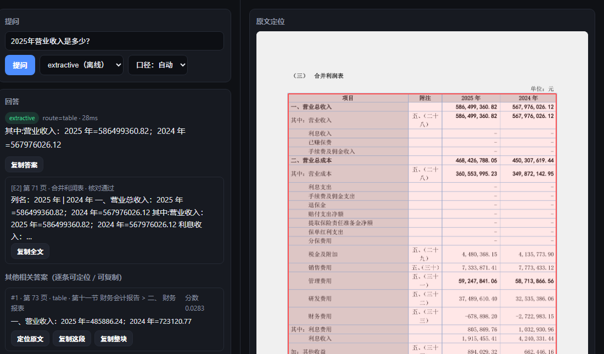
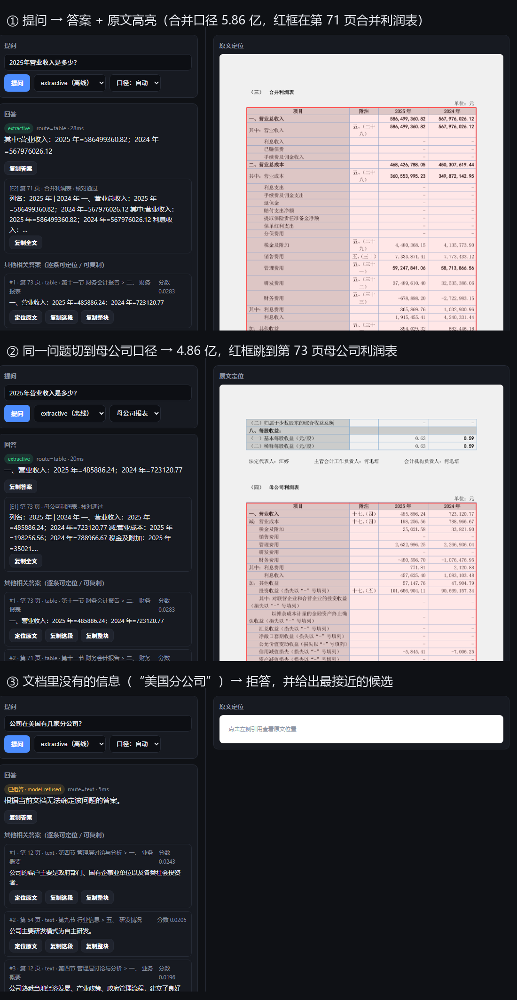

# DocProof（卷证）

> 可溯源的中文文档问答：把 PDF 里的表格、图、跨页正文变成带「页码 + 坐标」的**证据单元**，
> 每个回答都能点回原文，证据不足时敢拒答。



<p align="center"><i>问"2025 年营业收入是多少"：中间给答案与引用，右侧红框直接标在第 71 页合并利润表的对应行</i></p>

> **想直接跑**：装好 Ollama（`bge-m3` + `qwen3:8b`）后三条命令即可——`make_corpus.py` → `build_index.py --reset` → `uvicorn`，详见 [使用指南](docs/使用指南.md)。

**当前状态：v0.1 / MVP-1 已跑通**（2026-11-16）
端到端可运行：解析 → DocIR → 结构切分 → 混合检索 → 生成/拒答 → 引用高亮 → 评测。
环境：Windows + RTX 4060 8G + Ollama（qwen3:8b / bge-m3）+ Python 3.12。

**读完这份想跑起来，看 [使用指南](docs/使用指南.md)（5 分钟、含 FAQ）。**

| 文档 | 内容 | 什么时候看 |
|---|---|---|
| [**使用指南**](docs/使用指南.md) | 环境、5 分钟跑通、界面用法、CLI 速查、FAQ | **先读这份** |
| [开发计划](docs/00-开发计划.md) | 诊断、定位、模块、技术栈、排期、风险、面试 | 想改方案时 |
| [评测报告](docs/eval-report-v0.1.md) | 消融、置信区间、真实口语压测、11 个 bug 修复 | 想复现数字时 |
| [MVP 与 8G 方案](docs/03-MVP与8G算力方案.md) | 显存账本、分阶段加载、DoD | 换机器时 |
| [模型接入与切换](docs/04-模型接入与切换策略.md) | Ollama 先行、DeepSeek 收尾、VLM 现实 | 接模型时 |
| [面试速查卡](docs/02-面试速查卡.md) | 话术、Demo 动线、13 个追问 | 投递前 |

---

## 1. 实测结果（真的跑出来的，不是估计）

**语料**：6 份合成中文年报（每份 7 页，含跨页表、图、分季度表），**76 道题**（T1 事实 / T2 表格数值 / T3 表格比较 / T4 图表 / T5 跨页多值 / T6 不可回答）。
**生成器固定为 extractive**（确定性抽取式），这样消融的差异只能来自解析/切分/检索，而不是模型抽风。

| 组 | 配置 | 准确率 | T1 | T2 表格 | T3 比较 | T4 图表 | T5 跨页 | 引用准确率 | 误拒率 | p95 |
|---|---|---|---|---|---|---|---|---|---|---|
| B0 | 定长 512 + BM25（**旧方案基线**） | **46.9%** | 100% | 55% | 0% | 0% | 0% | 73% | 19% | 6ms |
| B1 | + 结构感知切分（DocIR） | 56.2% | 100% | 55% | 0% | **100%** | 0% | 75% | 11% | 3ms |
| **B2** | **+ 表头随行序列化 + 表格算子** | **98.4%** | 100% | **100%** | **100%** | 100% | 83% | 76% | 2% | 4ms |
| B3 | + 向量混合 + RRF | 98.4% | 100% | 100% | 100% | 100% | 83% | 76% | 2% | 4ms |
| B4 | + 题型路由 | 98.4% | 100% | 100% | 100% | 100% | 83% | 76% | 2% | 4ms |

**B0 → B2：+51.6pp，95% CI [39.1, 64.1]，McNemar p < 1e-4，33 胜 0 负（n=64 可答题）。**

四条可讲的结论：

1. **结构切分 +9.4pp**：图表题从 0% 到 100%——图注和图终于成了一个可检索的块。
2. **表头随行 +42.2pp**：扁平化时"第三季度"和"12.4"分散在不同行，列名只能猜；改成每行自带列名后，
   比较题、跨页多值题、计算题才**拿得到输入**（三个算子的前提就是这个结构）。
3. **向量混合与题型路由都没有增量（两个负结果）**：B2 已经把这类题吃干净，再加一层只会增加延迟与复杂度。
4. **上一版“路由 +7.8pp”是假象**：那 7.8pp 来自财务报表里"空标签行"（`：=五、净利润…`）造成的检索噪声，
   清掉垃圾行之后路由不再有增量。结论被自己的修复推翻——这比硬保一个漂亮数字更有价值。

> ⚠️ 98.4% 是**合成语料的上限**：题目模板化、算子按题型写。真实口语提问只有 **67%**（见 1.2）。

### 1.1 真实年报验证（不是分数，是可用性）

从巨潮资讯拉了 2 份**真实年报**跑同一条管线：

| 文档 | 页数 | 块 | 表 | 图 | 解析+索引 |
|---|---|---|---|---|---|
| 广咨国际 2025 年报 | 161 | 2362 | 220 | 18 | 107s |
| ST东时 2025 年报 | 277 | 3704 | 293 | 11 | 146s |

人工抽查 5 道自由提问（无金标，逐条核对原文）：

| 问题 | 结果 |
|---|---|
| 广咨国际 2025 年营业收入 | ✅ `586499360.82`（第 8 页表格） |
| 广咨国际研发投入占比 | ✅ 6.39% |
| 广咨国际的会计师事务所 | ✅ 华兴会计师事务所（完整句子） |
| ST东时 2025 年营业收入 | ✅ `617884577.90` |
| 2027 年营业收入是多少 | ✅ 拒答（number_absent） |

真实文档逼出来的三个修复（都已合并进主干）：

| 问题 | 现象 | 修复 |
|---|---|---|
| **合并表头** | 列名解析成空（`列名： \| 项目 \|  \|`） | 用单元格矩形相等性还原 rowspan/colspan，被覆盖列**继承锚点文本**，多行表头按 `/` 拼接 |
| **千分位 / 括号负数** | `586,499,360.82`、`（1,234）` | 单元格清洗：全角转半角、去千分位、括号负数转负号 |
| **排版换行被当句末** | "…星湖街" / "199 号" 被切成两句，地址答一半 | 段落内换行直接拼接，只有句读才切分 |

修完表头后，真实年报表头从空值变成
`['主要会计数据','2025年','2024年','本期比上年同期增减(%)','2023年']`，行式序列化才真正可用。

还剩的问题：**277 页索引 146s**（需异步）、**城投那 1 道 T5 仍失败**（续表未被识别为表格）。

### 1.2 真实口语提问压测（15 题）

同一份广咨国际年报，按真实用户的说法问 15 题（`eval/datasets/real_qa.jsonl`，`python scripts/eval_real.py`）：

> **13/15 = 87%**（加口径标签前 10/15 = 67%）。

关键的一步是**给财务报表打上（主体, 报表名）标签**：真实年报里"合并营业收入"和"母公司营业收入"
字面上完全一样，检索层无法区分。用报表标题（本页或上一页页首）判断主体后：

| 题 | 修复前 | 修复后 |
|---|---|---|
| 2025 年营业收入 | 母公司 `485886.24` ❌ | 合并 `586499360.82` ✅ |
| 2024 年营业收入 | 同上 ❌ | `567976026.12` ✅ |

剩下的 3 道错题，各自是不同的失败模式：

| 失败类型 | 例子 | 真实原因 |
|---|---|---|
| 年份歧义 | "研发人员"答 112（2024），正确 124（2025） | 叙述句先说旧年份，年份只在列名里 |
| 检索偏差 | "审计机构"答成审计委员会会议记录 | 真实表述是"聘任华兴会计师事务所" |
| 子公司资料表 | 总资产答成子公司 5.09 亿，集团 9.12 亿 | 子公司简介表长得很像财务摘要，没有报表标签 |

**结论**：口径标签是唯一有效的杠杆——加权重只能让分数在 9~10 之间来回跳，
而给数值打上"哪张表"的标签，直接 +13pp。这也是这个项目最值得讲的方法论。

UI 上已有「口径：自动 / 合并 / 母公司」开关，同一个问题可以现场对照两种口径：

```
2025年营业收入是多少？  口径=自动/合并 → 586499360.82（第 71 页 · 合并利润表）
2025年营业收入是多少？  口径=母公司    → 485886.24   （第 73 页 · 母公司利润表）
```

### 1.3 三步看懂（一张图）



1. **提问 → 答案 + 原文高亮**：合并口径 5.86 亿，红框落在第 71 页合并利润表的"营业收入"两行；
2. **切到母公司口径** → 同一个问题变成 4.86 亿，红框跳到第 73 页母公司利润表；
3. **问文档里没有的东西** → 拒答，同时给出最接近的候选（可选"定位原文"）。

> 截图是用无头 Chrome 打开真实服务（`?doc=&q=` 深链）截的，不是画的示意图。

---

## 2. 60 秒跑起来

```powershell
# 0) 依赖（已有 .venv312 可跳过）
D:\anaconda1\python.exe -m venv .venv312
.\.venv312\Scripts\python.exe -m pip install -r requirements.txt

# 1) 造语料（6 份 PDF + 76 道金标题）——不需要外部下载
.\.venv312\Scripts\python.exe scripts\make_corpus.py

# 2) 建索引（需要 ollama serve + bge-m3）
.\.venv312\Scripts\python.exe scripts\build_index.py --reset

# 3) 消融评测（4 组，约 10 秒）
.\.venv312\Scripts\python.exe src\docproof\eval\runner.py

# 4) 起 Web 服务
$env:PYTHONPATH="$PWD\src"
.\.venv312\Scripts\python.exe -m uvicorn docproof.api.app:app --port 7860
# 打开 http://127.0.0.1:7860
```

单题调试：

```powershell
.\.venv312\Scripts\python.exe scripts\ask.py "第三季度营业收入是多少亿元？" --provider extractive
.\.venv312\Scripts\python.exe scripts\ask.py "第三季度营业收入相比上年同期增长了多少？" --provider ollama
```

测试：`.\.venv312\Scripts\python.exe -m pytest tests -q` → 9 passed。

---

## 3. 架构

```
PDF ──► 解析层 ──────────────► DocIR ──► 结构切分 ──► 索引 ──► 检索 ──► 生成 ──► 答案+引用
        PyMuPDF 文本/bbox        block   子块/父块     BM25     RRF      extractive   bbox 高亮
        find_tables 表格        page    表头随行      向量     rerank   ollama 8B    引用校验
        image block 图           section 续表合并      SQLite            deepseek     阈值拒答
```

- **解析**：文本层 + `find_tables`（按单元格矩形逐格取字，避开 `extract()` 的乱序 bug）+ 图像块。
- **DocIR**：`page / bbox(归一化) / type / section / html / cells`，只保留"检索、引用、展示"三类字段。
- **切分**：标题并入下文、表格整表、图 = 图注 + 邻文、跨页续表并回、子块 240 字 / 父块 1600 字。
- **检索**：BM25（jieba + 数字特判）+ bge-m3 向量，RRF 融合；题型路由（表/图/文）。
- **生成**：`extractive`（消融用，确定性）/ `ollama`（交互）/ `deepseek`（终版，待 key）。
- **拒答**：数字闸门（问 2025 年，文档里没有 2025 → 直接拒）+ 覆盖度校验。

---

## 4. 目录

```
src/docproof/
  ingest/      pdf_text.py  tables.py  pipeline.py   # 解析 → DocIR
  ir.py                                              # DocIR 定义 + 表格两种视图
  chunking/    structural.py                         # 结构切分 / 定长基线 / 续表合并
  index/       bm25.py  dense.py  store.py           # 检索索引 + SQLite
  retrieve/    hybrid.py                             # RRF 融合 + 路由
  generate/    providers.py  answer.py               # 三种 provider + 引用校验 + 拒答
  eval/        metrics.py  runner.py                 # 指标 + 消融 runner
  api/         app.py  templates/index.html          # FastAPI + 高亮前端
scripts/       make_corpus.py  build_index.py  ask.py  inspect_doc.py
eval/          datasets/gold.jsonl  reports/ablation.{md,json}
tests/         test_smoke.py
```

---

## 5. 四个关键实现决策

| 决策 | 选择 | 为什么 | 代价 |
|---|---|---|---|
| 表格表示 | HTML + 单元格 bbox + **行式文本** | 要引用就必须有坐标；要检索就必须每行自带列名 | 存储变大、prompt 变长 |
| 切分 | 结构优先，定长兜底 | 表格/图一旦被切断就永久丢信息 | 规则多、边界情况多 |
| 生成 | 先本地 8B，终版切 DeepSeek | 8G 跑不动 7B VLM；本地零成本迭代 | 8B 12–18s/题，只能小批量 |
| 框架 | 不用 LangChain，薄封装 | 要能单独关掉每一层做消融 | 前期多写代码 |

---

## 6. 已知问题（诚实清单）

1. **T5 还剩 1/6 失败**：城投的续表没被识别成表格，合并逻辑没触发（E9 类问题）。
2. **真实口语 87%**：剩 2 题——研发人员 112/124 的年份歧义、总资产答成子公司表。
3. **引用准确率 76%**：计算型答案（"增长 3.2 亿元"）的 3.2 不在原文里，只能校验依据的两个数。
4. **向量混合与题型路由都没有增量**：B2 之后再加层只会增加延迟。
5. **表格算子是解题型写的**，题目模板化——98.4% 是上限，不是真实水平。
6. **图表题的答案是图注文本**，不是真读图；VLM 直读还没接。
7. **索引是同步的**：277 页 146s，上传会阻塞；队列/进度在 V1.5。

---

## 7. 下一步

- **MVP-2**：真实年报 30 份 + 300 题；接 Qwen-VL 做 L3；把表格算子用在自由口语提问上验证命中率；异步队列。
- **V1.5**：限流/重试/缓存/成本面板 + 压测。

详细方案见 [开发计划](docs/00-开发计划.md)、[MVP 与 8G 算力方案](docs/03-MVP与8G算力方案.md)、
[模型接入与切换](docs/04-模型接入与切换策略.md)，实测细节见 [v0.1 评测报告](docs/eval-report-v0.1.md)，
上手操作见 [使用指南](docs/使用指南.md)。
